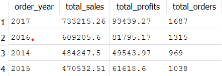

# Superstore Sales Analysis with SQL

An end-to-end SQL analysis of a retail dataset, answering real business questions about sales, profit, customers and products using SQLite.

## Dataset

- **Source:** Superstore sample dataset (`Sample - Superstore.csv`)
- **Size:** 9,994 order lines, 21 columns
- **Period:** orders from 2014 to 2017
- **Main columns:** Order ID, Order Date, Customer ID, Segment, Region, Category, Sub-Category, Product Name, Sales, Quantity, Discount, Profit

## Tools

- SQLite
- DB Browser for SQLite

## Project Structure

```
Superstore-SQL-Analysis/
├── dataset/
│   └── Sample - Superstore.csv
├── sql/
│   ├── 01_sales_analysis.sql
│   ├── 02_customer_product_analysis.sql
│   └── 03_advanced_analysis.sql
├── reports/
│   └── (result screenshots)
├── superstore.db
└── README.md
```

| File | What it does |
|---|---|
| `01_sales_analysis.sql` | Creates a helper view with year and month, then analyzes sales and profit by year, month, category and region, plus average discount and average order value |
| `02_customer_product_analysis.sql` | Finds top customers, compares segments, and ranks products and sub-categories by sales and profit |
| `03_advanced_analysis.sql` | Uses CTEs and window functions for year-over-year growth, profit rankings, top product per category and running totals |

## Business Questions

1. How did sales and profit change from 2014 to 2017?
2. Which months are the strongest for sales?
3. Which categories and regions have the weakest profit margins?
4. Do discounts explain the low margin in some categories?
5. How much of the sales come from the top 10 customers?
6. Which sub-categories and products lose money?

## Key Findings

- Total sales were **2,297,201** with a profit of **286,397** (about **12.47%** margin) across **5,009 orders** and **793 customers**.
- Sales grew by **51.41%** from 484,247 in 2014 to 733,215 in 2017, with a small dip in 2015.
- **November** (352,461) and **December** (325,294) are the strongest months, so sales are concentrated at the end of the year.
- **Furniture** has a profit margin of only **2.49%** despite 741,999 in sales, compared with 17.40% for Technology and 17.04% for Office Supplies.
- The **Central** region has the weakest margin at **7.92%**, about half of the West region (14.94%).
- **Tables** lose about **17,725** in profit despite about 206,966 in sales, which pulls down the whole Furniture category.

## Screenshots

### Sales and profit by year


### Profit margin by category


### Profit margin by region


### Top 10 products by sales


### Profit by sub-category


## How to Run

1. Install [DB Browser for SQLite](https://sqlitebrowser.org/).
2. Open `superstore.db` (File > Open Database).
3. Go to the **Execute SQL** tab and open the files from the `sql` folder in order: `01`, `02`, then `03`.
4. Press **Ctrl+Enter** to run a file.

Note: `01_sales_analysis.sql` creates the `orders_clean` view that the other files use, so run it first.

To rebuild the database from scratch, create a new database and import `dataset/Sample - Superstore.csv` with **File > Import > Table from CSV file**, naming the table `superstore`.

## Next Steps

- Build an interactive Power BI dashboard using the same Superstore data.
- Extend the analysis with statistics and Python (Pandas).

## Author

Marina Maged Fouad
